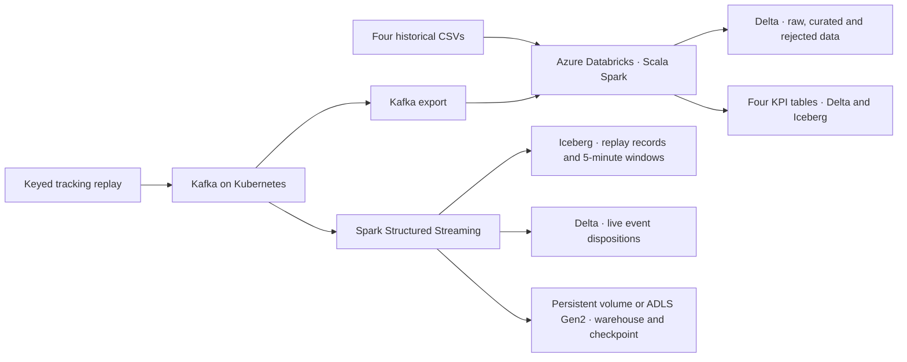

# Project Meridian

Meridian cleans historical shipment data, publishes delivery KPIs, and replays tracking events through Kafka and Spark. The capstone brief describes 8,768 shipment records. The supplied mini training pack contains 141 shipment rows, including eight re-sent versions. All reported results validate behavior on that mini pack. Full-dataset and production-volume validation remain outside the demonstrated scope.

See the [requirements and evidence matrix](docs/requirements-compliance.md) and the [final presentation walkthrough](demo-guide.md).

## Architecture



## Run the batch notebook

1. Open a Scala notebook on Azure Databricks classic compute. For the managed Iceberg steps, use Databricks Runtime 16.4 LTS or above and an output schema with predictive optimization enabled.
2. Upload the four CSVs under `Logistics/Data/batch/raw` to the same Unity Catalog volume folder. Import `01_Shipments_Batch.scala` as a source notebook. Set the **Input volume** and **Output catalog and schema** widgets for your workspace.
3. Run the batch, KPI and Iceberg cells in order. Use a dedicated writable schema for verification because the notebook replaces the Meridian output tables. Run the tracking audit cells after uploading `meridian-kafka-events.jsonl` alongside the CSVs.

The batch starts with 141 shipment rows and retains 133 latest shipment versions before the quality split. The four KPI outputs cover monthly delivery performance, carrier SLA, lane performance, and delay reasons.

Run `meridian-business-queries.sql` in Databricks SQL for shipment counts by status and monthly freight revenue by customer segment.

## Run the portable batch job

Build `docker build -f meridian-batch.Dockerfile -t meridian-batch:v1 .` and run `docker run --rm meridian-batch:v1` for a local smoke test. To run it on Kubernetes, make the image available to the node and apply `meridian-batch-job.yaml`. Use `kubectl --context docker-desktop logs job/meridian-batch` for the completion counts. The packaged job writes four raw Delta datasets and the curated and rejected shipment datasets under `/tmp/meridian-batch` inside the container. Its default output is temporary, while the Databricks tables retain the published outputs.

## Run the Kubernetes replay

Prerequisites are Docker Desktop with Kubernetes enabled, `kubectl`, a Kafka Service named `meridian-kafka`, and a writable `ReadWriteOnce` PVC named `meridian-stream-state`. The demo used the `docker-desktop` context and the default namespace.

Apply `kubectl --context docker-desktop apply -f meridian-kafka.yaml` to create the demo broker, Service, and streaming PVC. The broker is disposable and the PVC stores the consumer state.

1. Use a single Kafka partition for `shipment-tracking-events`. Replay the supplied keyed text file with Kafka's console producer and `key.separator=|`. Confirm the topic end offset is 43 before starting Spark.
2. Build the versioned Spark image and make it available to the Kubernetes node. Create the consumer ConfigMap and apply the deployment from the repository root.

   ```powershell
   docker build -f meridian-stream.Dockerfile -t meridian-stream:v1 .
   kubectl --context docker-desktop create configmap meridian-stream `
     --from-literal=KAFKA_BOOTSTRAP_SERVERS=meridian-kafka:9092 `
     --from-literal=KAFKA_TOPIC=shipment-tracking-events
   kubectl --context docker-desktop apply -f meridian-stream-deployment.yaml
   kubectl --context docker-desktop rollout status deployment/meridian-stream --timeout=300s
   kubectl --context docker-desktop logs deployment/meridian-stream
   ```

3. For the producer deployment, build `docker build -f meridian-producer.Dockerfile -t meridian-producer:v1 .`. Make the image available to the Kubernetes node, create the single-partition topic `shipment-tracking-producer-demo`, and apply `meridian-producer-deployment.yaml`. The separate topic lets the producer scaling demo run independently of the consumer recovery test. Each new producer replica publishes a full 43-event replay.
4. For recovery, save the consumer logs, replace the Spark pod, and wait for the deployment to become ready. Compare its output with the first run. The same checkpoint should yield zero new input records, 43 persisted records, and identical windows.
5. For the Databricks audit, consume 43 values from `shipment-tracking-events` in order, save them as `meridian-kafka-events.jsonl`, and upload the file to the notebook's input volume.

The initial local replay and its replacement both retained 43 raw Kafka records. The replacement processed zero new records and reproduced the same 12 windows. The separate ADLS run started with the same 43-event fixture plus one deliberately late event. It recovered 44 raw records after pod replacement, then processed one additional accepted event. The final 45 raw records comprise 33 accepted, 7 duplicate, 4 rejected, and 1 late. See the [reproduction steps](demo-guide.md#reproduce-the-adls-event-counts) and [ADLS verification log](meridian-adls-recovery-verification.log).

## Run the continuous consumer

With the Kubernetes Kafka broker and PVC running, use `powershell -NoProfile -ExecutionPolicy Bypass -File .\start-meridian-live.ps1`. This creates a separate `shipment-tracking-live` topic and deploys a Spark consumer that checks for events every ten seconds. It uses a separate checkpoint and Iceberg warehouse so the finite replay remains reproducible. Publish keyed events to the live topic to see new micro-batches in `kubectl --context docker-desktop logs -f deployment/meridian-stream-live`.

To use ADLS Gen2, provision an authorized Entra service principal and put its tenant ID, app client ID, and client secret in the `meridian-adls-auth` Kubernetes Secret as `AZURE_TENANT_ID`, `AZURE_CLIENT_ID`, and `AZURE_CLIENT_SECRET`. Use `meridian-adls-probe.yaml` to verify a Spark pod can write and read the project storage folder. Then pass `-Adls` to `start-meridian-live.ps1`. That mode uses its own Kafka topic and writes its checkpoint, Iceberg tables, and Delta event audit under the ADLS `meridian/streaming` prefix. Use `-RunId <suffix>` to start an independent run with a separate deployment, topic, checkpoint and warehouse. Keep the topic and storage paths consistent across pod replacements.

The streaming Deployment uses `Recreate` so Kubernetes terminates the old pod before starting its replacement during a Deployment update. One Spark writer owns the checkpoint and warehouse at a time, including when using ADLS. The update creates a short processing pause, then the replacement resumes from the durable checkpoint. The stateless producer uses a rolling update. Its update and rollback are in the [Kubernetes rollout log](evidence/kubernetes-producer-rollout.log).

## Assumptions and limits

- Batch keeps the newest shipment version by `last_updated` and the earliest signup date for repeated customer IDs. When those fields tie, lexical order of the serialized source row gives a deterministic result. Malformed shipment IDs go to the rejected table and are retained individually. Exact carrier and hub duplicates collapse. If distinct rows share an ID, the corresponding shipments are rejected because the reference data has no version timestamp. Historical shipments may still reference inactive hubs or carriers. Blank distance is permitted. Delivered and returned shipments require a completion date.
- Each batch input is a complete historical snapshot. After initial publication, the curated Delta table merges changed rows by shipment ID, inserts new rows, and removes rows absent from the current validated snapshot. Supply a complete snapshot when rerunning the batch.
- Delivery KPIs use delivered shipments and shipment month. Revenue and volume exclude cancellations. The streaming replay uses UTC event time, five-minute windows, and a five-minute arrival delay threshold. Clock-skewed events are flagged. The first valid copy of an event ID wins in the single-partition replay.
- Delta stores batch layers and the live event audit. The consumer writes one Delta table at `event_audit` under the streaming warehouse, partitioned by disposition. The Databricks notebook can also create separate audit tables from a Kafka export. Iceberg stores published KPIs, raw Kafka replay records and streaming aggregates.
- The Kubernetes consumer supports finite replay and continuous modes. The versioned, non-root image includes its Scala code and Kafka, Delta, Iceberg, and ADLS dependencies. A failed continuous query exits so Kubernetes can restart it from its configured checkpoint.
- GitHub Actions builds the three workload images and checks the producer fixture count, non-root users, streaming dependencies, and packaged batch reconciliation.
- For larger datasets, broadcast sufficiently small reference tables to reduce shipment join shuffles. Replace full window recomputation with incremental updates and compact small Iceberg files as the number of writes grows.

## Delta Lake and Iceberg

Delta Lake fits the Databricks quality layers because the notebook can use native Spark writes and transaction history to trace curation and update shipments by key. Iceberg fits the published KPI and tracking outputs because analytics engines that support the Iceberg catalog can read the same snapshots and evolved schema. Publishing in both formats gives a portable analytics copy and requires extra storage, writes, and a parity check. The notebook compares all four published Iceberg KPI tables with their Delta sources.

The `Logistics` folder contains the original capstone brief and earlier companion copies of the Scala consumer and Kafka export. Build the current consumer from `meridian-stream.scala` at the repository root.

## Validate locally

Run `powershell -NoProfile -ExecutionPolicy Bypass -File .\validate-project.ps1` with Docker Desktop running. This builds and checks the producer image and verifies the saved batch and recovery results. This check does not require a Git remote. The Kubernetes batch and streaming logs must be present in the project root.

## Hosted CI

Both `producer-image` and `processing-images` passed on `main` for commit `1b7d12c0a56be37034cfbc24c6f123d5f7fbb217`. The workflow builds the images and checks the packaged batch reconciliation. [Verified Meridian CI run](https://github.com/ShanmukhaAaryasree/project-meridian/actions/runs/44895379150) · [Latest runs on main](https://github.com/ShanmukhaAaryasree/project-meridian/actions/workflows/ci.yml?query=branch%3Amain)
