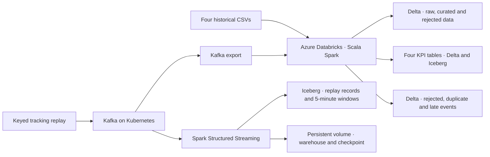

# Project Meridian

Meridian cleans historical shipment data, publishes delivery KPIs, and replays tracking events through Kafka and Spark. This demo uses the supplied mini training dataset.

## Architecture



## Run the batch notebook

1. Open a Scala notebook on Azure Databricks classic compute. For the managed Iceberg steps, use Databricks Runtime 16.4 LTS or above and a workspace configured for managed Iceberg.
2. Upload the four CSVs under `Logistics/Data/batch/raw` to a writable Unity Catalog volume. Import `01_Shipments_Batch.scala` as a source notebook. Set the input paths and output schema for your workspace. The demo used `/Volumes/aarya/default/application_files` and `aarya.default`.
3. Run the batch, KPI and Iceberg cells in order. Use a fresh writable schema for a clean rerun because the notebook creates named tables. Run the tracking audit cells after uploading the Kafka export.

The batch starts with 141 shipment rows and retains 133 latest shipment versions before the quality split. The four KPI outputs cover monthly delivery performance, carrier SLA, lane performance, and delay reasons.

## Run the Kubernetes replay

Prerequisites are Docker Desktop with Kubernetes enabled, `kubectl`, a Kafka Service named `meridian-kafka`, and a writable `ReadWriteOnce` PVC named `meridian-stream-state`. The demo used the `docker-desktop` context and the default namespace.

1. Use a single Kafka partition for `shipment-tracking-events`. Replay the supplied keyed text file with Kafka's console producer and `key.separator=|`. Confirm the topic end offset is 43 before starting Spark.
2. Create the consumer ConfigMap and apply the deployment from the repository root.

   ```powershell
   kubectl --context docker-desktop create configmap meridian-stream `
     --from-file=meridian-stream.scala `
     --from-literal=KAFKA_BOOTSTRAP_SERVERS=meridian-kafka:9092 `
     --from-literal=KAFKA_TOPIC=shipment-tracking-events
   kubectl --context docker-desktop apply -f meridian-stream-deployment.yaml
   kubectl --context docker-desktop rollout status deployment/meridian-stream --timeout=300s
   kubectl --context docker-desktop logs deployment/meridian-stream
   ```

3. For the producer deployment, build `docker build -f meridian-producer.Dockerfile -t meridian-producer:v1 .`. Make the image available to the Kubernetes node, create the single-partition topic `shipment-tracking-producer-demo`, and apply `meridian-producer-deployment.yaml`. The separate topic lets the producer scaling demo run independently of the consumer recovery test. Each new producer replica publishes a full 43-event replay.
4. For recovery, save the consumer logs, replace the Spark pod, and wait for the deployment to become ready. Compare its output with the first run. The same checkpoint should yield zero new input records, 43 persisted records, and identical windows.
5. For the Databricks audit, consume 43 values from `shipment-tracking-events` in order, save them as `meridian-kafka-events.jsonl`, and upload the file to the notebook's input volume.

## Assumptions and limits

- Batch keeps the newest shipment version by `last_updated` and the earliest signup date for repeated customer IDs. Historical shipments may still reference inactive hubs or carriers. Blank distance is permitted. Delivered and returned shipments require a completion date.
- Delivery KPIs use delivered shipments and shipment month. Revenue and volume exclude cancellations. The streaming replay uses UTC event time, five-minute windows, and a five-minute arrival delay threshold. Clock-skewed events are flagged. The first valid copy of an event ID wins in the single-partition replay.
- Delta stores batch layers and event audit records. Iceberg stores published KPIs and streaming aggregates and provides snapshots, time travel, and schema evolution. The audit is a separate Databricks step using the Kafka export.
- The Kubernetes streaming demo uses a finite replay and a local persistent volume for the warehouse and checkpoint. ADLS-backed Kubernetes recovery and an unbounded streaming run were outside this demo. The Spark consumer uses the upstream Spark image with the Scala source mounted through a ConfigMap.
- CI builds and checks the producer image on GitHub Actions. It exercises the packaged event count and container user. The Databricks notebook and Kubernetes replay are verified separately.
